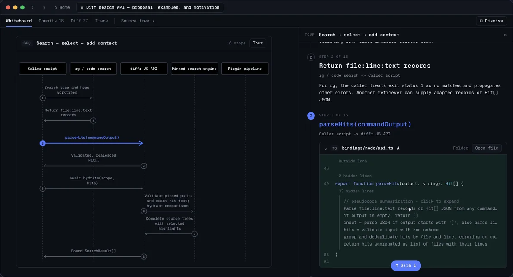

# Create a review

Once you [connect an agent](connect-your-agent.md), ask it to review your
changes. Keep Whiteboard open and run your agent in the repository. For example:

```text
Review changes from my current branch against main and open the result in Whiteboard.
```

## Read the review

The review appears in Whiteboard as your agent writes it. Select a diagram step
or code link to open its source.


